# BÁO CÁO ĐỒ ÁN MÔN HỌC — NHẬP MÔN HỌC MÁY VÀ KHAI PHÁ DỮ LIỆU (IT3190)

## Ước lượng giá thuê phòng trọ tại Hà Nội từ dữ liệu tin đăng trực tuyến

> **Bản nháp.** Số liệu lấy từ lần chạy `python src/run_pipeline.py` ngày 15/11/2026. Khi chạy lại pipeline trên dữ liệu
> mới, cập nhật các bảng theo `reports/`. Phần in nghiêng trong ngoặc vuông *[...]* là chỗ nhóm cần tự điền.

*[Nhóm 9 — danh sách thành viên, MSSV]*

---

## 1. Giới thiệu bài toán

### 1.1. Bối cảnh

Mỗi năm học, hàng chục nghìn sinh viên tại Hà Nội phải tìm phòng trọ. Thông tin cho thuê nằm rải rác trên nhiều trang
rao vặt, mỗi tin đăng mô tả theo một kiểu, và người thuê — nhất là sinh viên năm nhất — gần như không có cơ sở để biết
mức giá chủ trọ đưa ra là hợp lý hay đang bị "hét giá". Câu hỏi "phòng này giá như vậy có đắt không?" là câu hỏi thực tế,
có dữ liệu công khai để trả lời, và phù hợp với các phương pháp học máy của môn học.

### 1.2. Mục tiêu

Xây dựng hệ thống học máy:

- **ước lượng giá thuê hợp lý** (triệu đồng/tháng) của một phòng trọ từ thông tin trong tin đăng,
- đưa ra **khoảng giá phổ biến** (khoảng chứa 80% giá thực tế của các phòng tương tự),
- so sánh với giá chủ trọ đưa ra và **nhận xét đắt / hợp lý / rẻ** so với mặt bằng.

### 1.3. Đầu vào và đầu ra

| | Nội dung |
|---|---|
| **Đầu vào** | quận/huyện, phường/xã (không bắt buộc), diện tích (m²), tình trạng nội thất, mô tả tin đăng (văn bản tự do), giá chủ trọ đưa ra (không bắt buộc) |
| **Đầu ra** | giá ước tính (triệu/tháng), khoảng giá 80%, nhận xét so với giá chủ trọ, các tiện ích nhận diện từ mô tả, danh sách tin đăng tương tự |

### 1.4. Các bài toán con và chương tương ứng của môn học

| Bài toán | Phương pháp | Chương |
|---|---|---|
| Thu thập, làm sạch, tích hợp dữ liệu từ 3 nguồn | crawl, chuẩn hóa, lọc ngoại lai, khử trùng lặp | Ch. 2 |
| **Dự đoán giá thuê** (bài toán chính) | hồi quy tuyến tính, Ridge/Lasso, Random Forest, Gradient Boosting, TF-IDF | Ch. 3 |
| Phân cụm khu vực trọ | K-Means, Agglomerative, DBSCAN | Ch. 4 |
| Phân loại loại tin đăng (lọc nhiễu nhãn) | Logistic Regression, Naive Bayes, SVM, luật | Ch. 5 |
| Luật kết hợp tiện ích ↔ mức giá | Apriori | Ch. 6 |

---

## 2. Dữ liệu

### 2.1. Thu thập

Nhóm tự viết crawler cho 3 trang rao vặt phòng trọ lớn, khu vực Hà Nội:

| Nguồn | Cách lấy | Tọa độ | Số tin (sau bỏ trùng) |
|---|---|---|---|
| Chợ Tốt — mục Phòng trọ | API JSON công khai mà website sử dụng | có | 3.680 |
| phongtro123.com | phân tích HTML trang danh sách + trang chi tiết | không | 4.992 |
| mogi.vn | phân tích HTML trang danh sách + trang chi tiết | không | 1.805 |

Dữ liệu được crawl 7 lượt (8/10, 12/10, 16/10, 22/10, 01/11, 04/11, 15/11/2026) để vừa tích lũy tin mới, vừa có dữ liệu cho việc kiểm tra mô hình
trên tin đăng xuất hiện sau thời điểm huấn luyện (mục 4.5).

**Đạo đức thu thập:** chỉ truy cập các trang được robots.txt cho phép; giãn cách 1,5 giây giữa các request; không lưu
tên, số điện thoại, tài khoản người đăng (số điện thoại trong mô tả được thay bằng `<SĐT>`); dữ liệu chỉ dùng cho học tập,
không công bố lại.

### 2.2. Làm sạch và tích hợp

Nhật ký đầy đủ: `reports/cleaning_log.txt`.

| Bước | Số tin còn lại |
|---|---|
| Gộp 3 nguồn (sau bỏ trùng theo mã tin) | 10.477 |
| Bỏ tin thiếu giá | 10.445 |
| Bỏ giá ngoài [0,5; 30] triệu | 10.374 |
| Bỏ diện tích ngoài [5; 150] m² | 10.270 |
| Bỏ tin không xác định được vị trí | 10.247 |
| Bỏ giá/m² ngoài phân vị 1–99% | **10.079** |

Các vấn đề của dữ liệu thực tế và cách xử lý:

1. **Thiếu diện tích:** khoảng 52% tin Chợ Tốt (chủ yếu tin môi giới) không ghi diện tích. Nhóm tách diện tích từ mô tả
   bằng biểu thức chính quy khi có thể; các tin còn lại **được giữ** và gắn cờ `size_missing` thay vì xóa (xóa sẽ mất hơn
   1.000 tin và làm lệch dữ liệu về phía tin chính chủ).
2. **Không có tọa độ:** Phongtro123 và Mogi chỉ có địa chỉ chữ. Dịch vụ geocode (Nominatim) không truy cập được, nên tọa
   độ được suy ra bằng **trung vị tọa độ các tin Chợ Tốt cùng phường**. Thí nghiệm ở mục 4.3 cho thấy cách này không làm
   giảm độ chính xác.
3. **Địa giới hành chính thay đổi năm 2025:** Mogi dùng tên phường cũ, Phongtro123 dùng tên phường mới. Nhóm xây bảng
   đối chiếu phường cũ → phường mới từ các tin Chợ Tốt (có cả hai tên).
4. **Tin trùng lặp:** cùng một phòng được đăng lại nhiều lần hoặc đăng trên nhiều trang, thường với giá hoặc diện tích
   ghi lệch chút ít. Hai tin được coi là cùng một phòng nếu (a) cùng phường, cùng giá và cùng diện tích (diện tích phải
   có ghi), hoặc (b) cùng quận, mô tả giống nhau (cosine TF-IDF ≥ 0,85) và giá chênh không quá 10%; nhóm (`group_id`) là
   thành phần liên thông của đồ thị các cặp đó. Phiên bản đầu chỉ dùng khóa (phường, giá, diện tích) và có lỗi: mọi tin
   **thiếu** diện tích cùng phường, cùng giá bị gộp thành một "phòng" (một nhóm hơn 1.200 tin). Nhóm được dùng để chia
   train/test (mục 3.6): 10.079 tin thuộc 6.918 phòng, 789 phòng xuất hiện ở hơn một nguồn.
5. **Giá ghi ngay trong mô tả:** khoảng 60% mô tả có chứa số tiền ("5tr6", "giá 3,5 tr", "3.500.000đ"). Nếu để nguyên,
   mô hình văn bản sẽ "đọc" luôn đáp án. Hàm `mask_money` xóa các cụm chỉ tiền trước khi tạo đặc trưng (có 36 unit test
   kiểm tra các hàm xử lý văn bản, `tests/`).
6. **Tin không phải "một phòng, một giá":** tin ở ghép (giá theo người/giường) và tin cho thuê nhiều phòng với nhiều mức
   giá là nhiễu với bài toán định giá — được xử lý bằng bài toán phân loại phụ (mục 3.2).

### 2.3. Khám phá dữ liệu

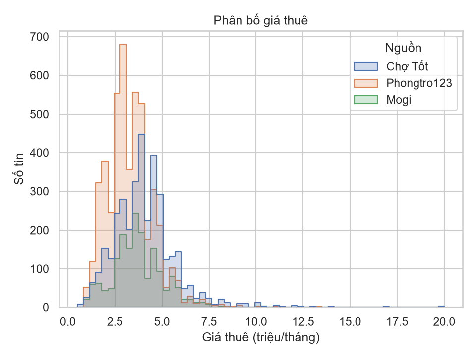

*Hình 1. Phân bố giá thuê theo nguồn tin. Phongtro123 tập trung ở phân khúc rẻ hơn Chợ Tốt và Mogi; các cột cao bất
thường ở 2,5 / 3 / 3,5 triệu là do người đăng thường làm tròn giá.*

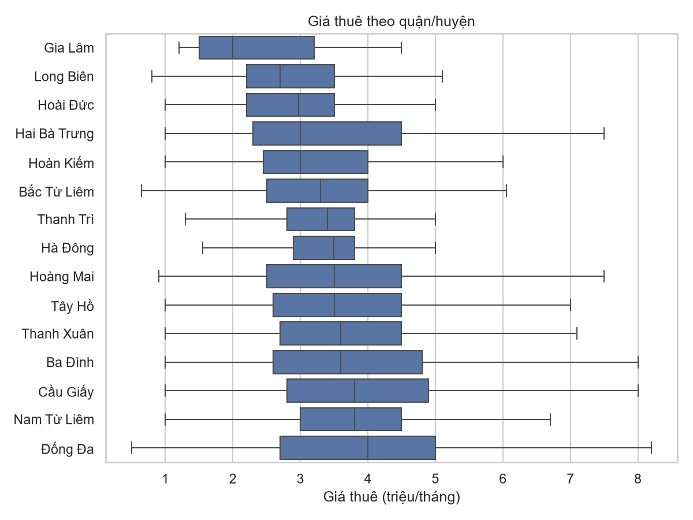

*Hình 2. Giá thuê theo quận/huyện (các quận có ≥ 30 tin, sắp theo giá trung vị; hộp là khoảng tứ phân vị, không vẽ
điểm ngoại lai).*

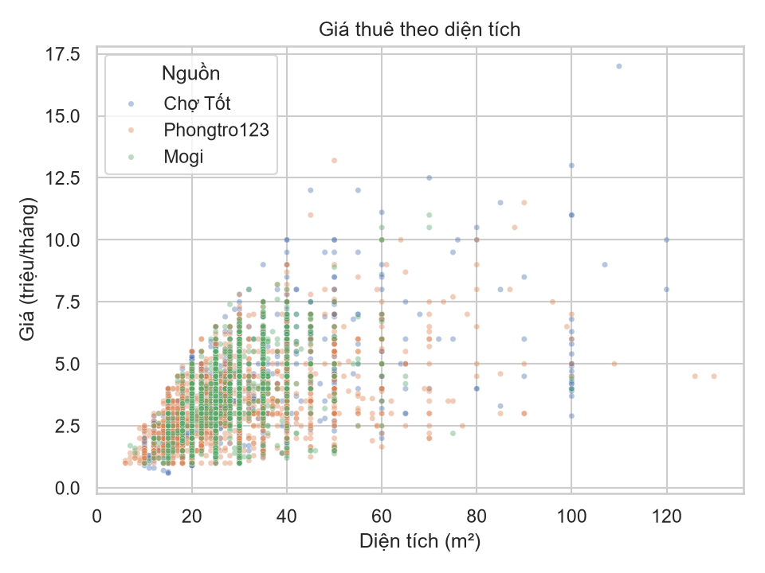

*Hình 3. Giá thuê theo diện tích. Cùng một diện tích, giá có thể chênh nhau 2–3 lần.*

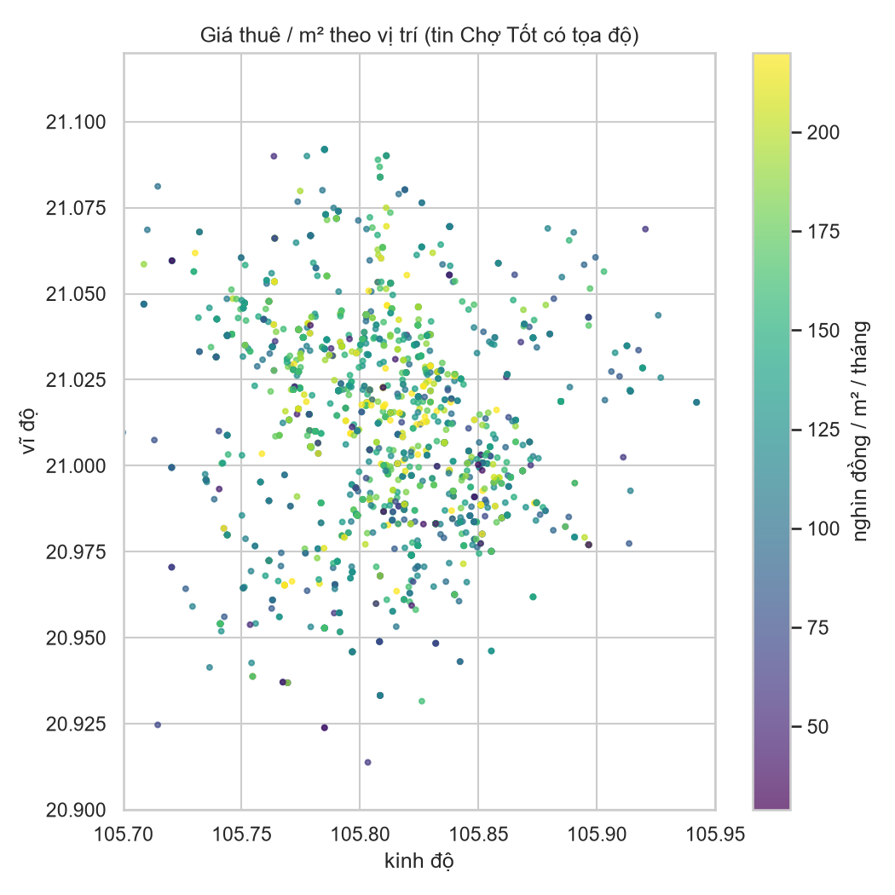

*Hình 4. Giá thuê / m² theo vị trí, chỉ gồm tin Chợ Tốt có tọa độ thật (Phongtro123 và Mogi chỉ có tọa độ suy ra theo
phường). Màu cắt ở phân vị 95% để không bị vài điểm cực đoan chi phối.*

- Giá thuê tập trung ở 2–5 triệu/tháng; giá trung vị khoảng 3,5 triệu.
- Đống Đa, Nam Từ Liêm, Cầu Giấy có giá trung vị cao nhất (3,8–4,0 triệu); Gia Lâm, Long Biên, Hoài Đức thấp nhất
  (2,0–3,0 triệu). Chênh lệch giữa các quận nội thành nhỏ (~3,5 triệu).
- Giá tăng theo diện tích nhưng phân tán rất mạnh: cùng 20 m² có phòng 2 triệu, có phòng 5 triệu → diện tích và vị
  trí là chưa đủ, cần thêm thông tin từ mô tả.

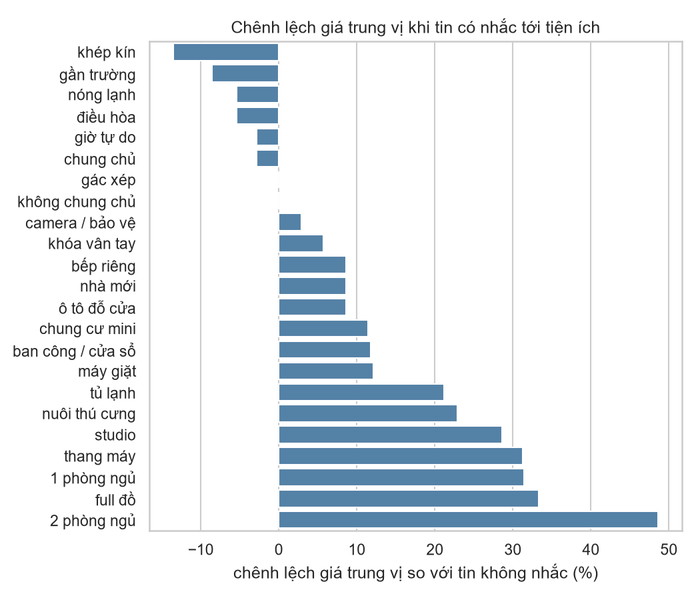

*Hình 5. Chênh lệch giá trung vị giữa tin có nhắc và tin không nhắc tới từng tiện ích (các tiện ích có ≥ 20 tin nhắc).*

**Tương quan không phải nhân quả** (Hình 5): tin nhắc "khép kín" có giá trung vị *thấp hơn* khoảng 13%
so với tin không nhắc. Lý do không phải "khép kín làm giảm giá", mà là phòng trọ bình dân mới cần quảng cáo điều này, còn
căn hộ mini 1N1K mặc định đã khép kín nên không ai ghi.

---

## 3. Phương pháp

### 3.1. Đặc trưng

| Nhóm | Đặc trưng |
|---|---|
| Kích thước | diện tích, log(diện tích), cờ thiếu diện tích |
| Vị trí | quận (one-hot), khoảng cách tới 7 trường đại học lớn và tới trung tâm (Hồ Hoàn Kiếm), khoảng cách tới trường gần nhất |
| Nội thất | tình trạng nội thất (Chợ Tốt có trường riêng) |
| Từ khóa | 23 từ khóa tiện ích tách từ mô tả đã bỏ dấu (khép kín, điều hòa, thang máy, máy giặt, gác xép, chung chủ, 1N1K…) |
| Văn bản | TF-IDF n-gram 1–2 từ trên mô tả đã bỏ dấu và đã che giá (tối đa 20.000 chiều) |
| Khác | nguồn tin, độ chính xác tọa độ, độ dài mô tả |

### 3.2. Phân loại loại tin đăng (bài toán phụ)

Phân tích lỗi của mô hình giá (mục 4.5) cho thấy các tin bị đoán sai nặng nhất phần lớn là tin mà **giá đăng không phải
giá của một phòng cụ thể**. Nhóm định nghĩa 3 lớp:

- **R** — phòng/căn riêng, một mức giá (đối tượng của bài toán định giá);
- **G** — ở ghép, giá tính theo người/giường (homestay, ký túc xá, sleepbox, "slot");
- **N** — tin cho thuê nhiều phòng / khoảng giá ("từ 3tr", "3tr5 – 4tr5", "tầng 1: 3,5 triệu, tầng 2: 3 triệu").

**Dữ liệu có nhãn:** 540 tin gán nhãn thủ công, gồm hai mẫu với vai trò khác nhau:
- 240 tin chọn **theo luật** (1/3 tin luật nghi là G, 1/3 nghi là N, 1/3 còn lại) — nhiều ví dụ lớp hiếm để học;
- 300 tin chọn **ngẫu nhiên hoàn toàn** — phản ánh phân bố thật (71% R, 22% N, 7% G), dùng để đánh giá khách quan.

Lý do cần mẫu ngẫu nhiên: nếu chỉ đánh giá trên mẫu chọn theo luật, điểm của chính luật đó bị **lạc quan** (luật đã quyết
định tin nào được chọn). Thực tế, macro-F1 của luật regex là 0,81 trên mẫu theo luật nhưng chỉ 0,75 trên mẫu ngẫu nhiên.

**Hướng dẫn gán nhãn và rà soát.** Câu hỏi khi gán nhãn là *"con số giá của tin này là giá của cái gì?"*; thứ tự ưu tiên
G → N → R và các trường hợp ranh giới (giá theo số người ở, nhiều phòng cùng giá, giá trong mô tả lệch giá đăng…) được
viết thành hướng dẫn (`docs/HUONG_DAN_GAN_NHAN.md`). Sau lần gán đầu, nhóm **đọc lại toàn bộ 540 tin** theo hướng dẫn
này (không chỉ những tin mô hình đoán khác nhãn, để tránh thiên lệch về phía mô hình): **26 nhãn (4,8%) được sửa, tất
cả từ R sang N** — đều là tin có khoảng giá hoặc nhiều mức giá nằm giữa mô tả mà lần đầu bỏ sót ("giá cả hợp lý: chỉ
từ 3 – 3,8 triệu", "còn 2 phòng 2,3tr và 2,6tr"). Nhật ký từng thay đổi kèm lý do: `data/labels/label_review_log.csv`.

**Phương pháp so sánh:** luật regex; TF-IDF (từ / ký tự) + Logistic Regression, Naive Bayes, Linear SVM; mô hình kết hợp
luật + TF-IDF + Logistic Regression; luật v2 có thêm đặc trưng **đếm số mức giá phòng khác nhau** trong mô tả (thêm sau
khi phân tích lỗi cho thấy lớp N bị bỏ sót nhiều). Đánh giá: Stratified 5-fold lặp 5 lần. **Chọn phương pháp:** phương
pháp đơn giản nhất (luật trước, rồi đến mô hình học máy) có macro-F1 trên mẫu ngẫu nhiên cách điểm cao nhất không quá
0,01 — chênh lệch nhỏ hơn mức này nằm trong dao động giữa các lần chia fold.

### 3.3. Mô hình hồi quy giá

Biến mục tiêu là **log(giá)** (giá lệch phải; sai số tương đối quan trọng hơn sai số tuyệt đối). Các mô hình so sánh,
từ đơn giản đến phức tạp:

1. **Dummy** — luôn đoán giá trung bình (mốc tối thiểu phải vượt qua);
2. **Linear Regression, Ridge, Lasso** trên đặc trưng có cấu trúc + từ khóa;
3. **Random Forest, HistGradientBoosting** (HGB) — bắt quan hệ phi tuyến;
4. **Ridge + TF-IDF** — mô hình tuyến tính có chính quy hóa trên đặc trưng văn bản thưa, nhiều chiều; alpha chọn bằng CV;
5. **Kết hợp**: trung bình có trọng số trên log giá, 0,7 × (Ridge + TF-IDF) + 0,3 × HGB.

**Nguồn tin** là một đặc trưng (mỗi trang có tập người đăng và phân khúc riêng). Khi người dùng tự nhập thông tin, hệ
thống lấy trung bình dự đoán trên cả 3 nguồn; khi đọc từ link thì dùng đúng nguồn của tin.

### 3.4. Khoảng giá thích nghi theo từng tin

Cách đơn giản: khoảng 80% = dự đoán + phân vị 10% / 90% của **phần dư out-of-fold** — mọi tin có cùng độ rộng (trên
thang log). Nhưng độ khó khác nhau giữa các nguồn tin và giữa các mức giá. Nhóm dùng **normalized conformal prediction**,
có thêm bước lấy phân vị theo nhóm:

1. phần dư out-of-fold r của mô hình chính;
2. "mô hình độ khó" g(x) — HistGradientBoosting dự đoán |r| từ đặc trưng (cũng out-of-fold). Độ lớn phần dư rất khó
   đoán, nên độ phức tạp của g được chọn theo RMSE out-of-fold (mô hình sâu học vẹt và làm khoảng rộng thừa);
3. điểm chuẩn hóa s = r / g(x); khoảng = dự đoán + [phân vị 10% của s; phân vị 90% của s] × g(x);
4. phân vị ở bước 3 lấy **riêng cho từng mức giá dự đoán** (6 mức, mỗi mức ≥ 700 tin). Người dùng chỉ nhìn thấy giá dự
   đoán, nên độ phủ cần đúng 80% ở từng mức giá dự đoán chứ không chỉ đúng khi gộp tất cả.

Đánh giá bằng GroupKFold (phân vị lấy từ các fold khác fold đang chấm): độ phủ (mục tiêu 80%) và độ rộng trung bình,
tổng thể và theo từng nhóm tin (`src/intervals.py`, kết quả ở mục 4.4).

### 3.5. Phân cụm khu vực và luật kết hợp

- **Phân cụm:** mỗi phường có ≥ 10 tin phòng riêng được mô tả bằng giá/m² trung vị, log khoảng cách tới trung tâm và tới
  trường gần nhất, tỉ lệ tin có các tiện ích chính; chuẩn hóa z-score. Số cụm k chọn bằng Silhouette và Davies-Bouldin;
  so sánh K-Means, Agglomerative (Ward), DBSCAN; so sánh 3 bộ đặc trưng.
- **Luật kết hợp:** mỗi tin là một giao dịch gồm các tiện ích, mức giá (tam phân vị: thấp / trung bình / cao) và cụm khu
  vực; Apriori với support ≥ 0,03, confidence ≥ 0,5, lift ≥ 1,2.

### 3.6. Thiết kế đánh giá

- **GroupKFold 5-fold theo `group_id`:** các tin của cùng một phòng luôn nằm cùng phía train hoặc test. Nếu chia ngẫu
  nhiên, mô hình được "xem trước" tin đăng lại của chính phòng trong tập test → điểm đẹp giả (định lượng ở mục 4.1).
- **Thang đo:** MAE, RMSE (triệu đồng), MAPE (%), R² — tính trên thang giá gốc.
- **Kiểm tra trên tin đăng mới:** huấn luyện trên tin có từ đợt crawl 8/10, chấm trên tin chỉ xuất hiện từ 12/10.
- **Nested CV** cho phần tinh chỉnh siêu tham số (mục 4.3).

---

## 4. Kết quả thực nghiệm

Tập dùng cho mô hình giá: **7.409 tin phòng riêng** (loại R) trong 10.079 tin sau làm sạch (dữ liệu đến 15/11/2026).

### 4.1. So sánh mô hình hồi quy (GroupKFold 5-fold)

| Mô hình | MAE (triệu) | RMSE (triệu) | MAPE | R² |
|---|---|---|---|---|
| Dummy (trung bình) | 1,08 | 1,47 | 33,4% | −0,03 |
| Linear Regression | 0,68 | 0,97 | 19,5% | 0,55 |
| Ridge | 0,68 | 0,97 | 19,5% | 0,55 |
| Lasso | 0,68 | 0,97 | 19,5% | 0,55 |
| Random Forest | 0,65 | 0,94 | 18,6% | 0,58 |
| HistGradientBoosting | 0,64 | 0,92 | 18,2% | 0,60 |
| Ridge + TF-IDF | 0,60 | 0,87 | 17,2% | 0,64 |
| **Ridge + TF-IDF × 0,7 + HGB × 0,3** | **0,58** | **0,85** | **16,5%** | **0,66** |
| *cùng mô hình, KFold ngẫu nhiên* | *0,56* | *0,83* | *16,1%* | *0,67* |

Nhận xét:
- Mọi mô hình đều vượt xa mốc Dummy; mô hình tốt nhất giảm sai số trung bình từ 1,08 xuống 0,58 triệu.
- Trên đặc trưng có cấu trúc, mô hình cây (RF, HGB) chỉ hơn hồi quy tuyến tính một chút → quan hệ giữa giá và diện tích /
  vị trí khá gần tuyến tính trên thang log.
- Thêm **TF-IDF** là bước nhảy lớn nhất (R² 0,55 → 0,64).
- **Kết hợp** Ridge + TF-IDF (mạnh về văn bản) với HGB (mạnh về phi tuyến trên đặc trưng có cấu trúc) tốt hơn từng mô
  hình riêng lẻ.

**Về rò rỉ do tin trùng — một lỗi nhóm đã phát hiện và sửa.** Ở phiên bản đầu, nhóm tin được tạo bằng khóa (phường, giá,
diện tích); khóa này gộp nhầm mọi tin *không ghi* diện tích cùng phường, cùng giá thành một "phòng" (một nhóm hơn 1.200
tin). Khi chia GroupKFold, cả nhóm đó rơi vào một fold làm fold này lệch hẳn phân bố, nên điểm GroupKFold thấp giả và
chênh lệch ~0,08 R² so với KFold ngẫu nhiên bị hiểu nhầm là "rò rỉ do tin trùng". Sau khi sửa cách gom (mục 2.2), chênh
lệch thật chỉ ~0,01: tin đăng lại có tồn tại (4.454 / 10.079 tin nằm chung nhóm với ít nhất một tin khác) nhưng không làm
kết quả đẹp giả đáng kể. Bài học: một bước tiền xử lý tưởng như phụ (tạo nhóm) có thể làm sai lệch cả kết luận đánh giá.

### 4.2. Đặc trưng nào quan trọng? (ablation, Ridge + TF-IDF)

| Cấu hình | MAE (triệu) | R² |
|---|---|---|
| Đầy đủ đặc trưng | 0,60 | 0,64 |
| Bỏ văn bản (từ khóa + TF-IDF) | 0,79 | 0,41 |
| Bỏ diện tích | 0,67 | 0,56 |
| Bỏ vị trí (khoảng cách + quận) | 0,61 | 0,63 |
| Bỏ nội thất | 0,60 | 0,64 |

| Biểu diễn văn bản | R² |
|---|---|
| Không dùng văn bản | 0,41 |
| 23 từ khóa thủ công | 0,55 |
| TF-IDF n-gram từ | 0,64 |
| TF-IDF n-gram ký tự | 0,64 |
| TF-IDF từ + ký tự | 0,64 |

**Văn bản mô tả là thông tin quan trọng nhất**, hơn cả vị trí. Mô tả chứa loại phòng (phòng trọ hay 1N1K, studio), tình
trạng (mới xây, full đồ, thang máy), vệ sinh chung hay khép kín — những yếu tố quyết định giá mà không có trường dữ liệu
riêng. Vị trí đóng góp ít vì phần lớn tin ở các quận nội thành có mặt bằng giá gần nhau, và một phần thông tin vị trí đã
nằm trong văn bản (tên đường, tên trường). Thêm **phường** (one-hot) cũng không cải thiện (R² 0,640 so với 0,642).
TF-IDF ký tự (bắt viết tắt "vskk", "1n1k") không hơn TF-IDF từ.

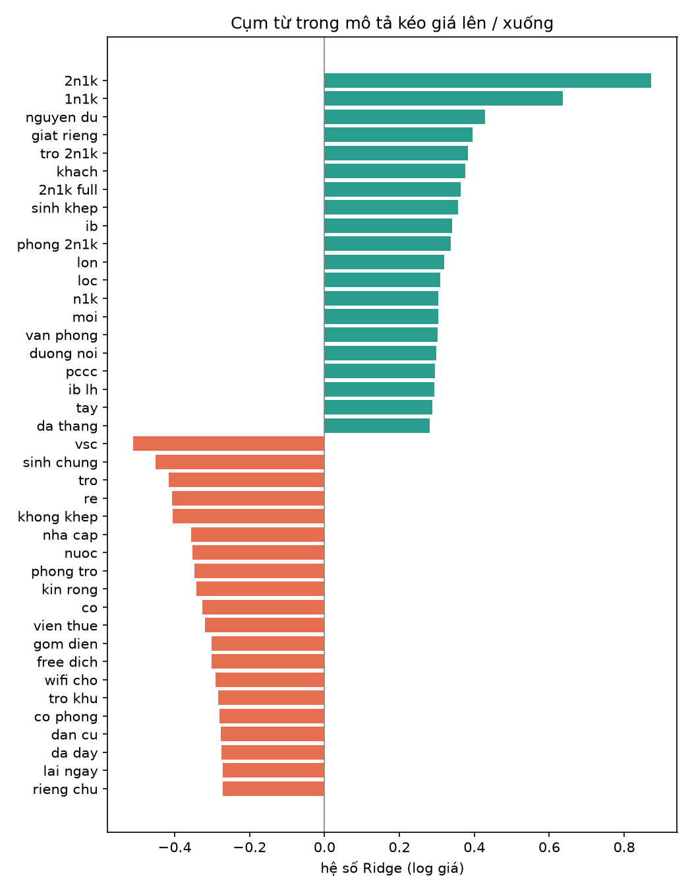

*Hình 6. 20 cụm từ có hệ số Ridge dương lớn nhất (kéo giá lên) và âm lớn nhất (kéo giá xuống), trên văn bản đã bỏ dấu
và đã che giá. Một số cụm không phải tiện ích ("ib", "ib lh") phản ánh văn phong của tin môi giới.*

Cụm từ kéo giá **lên**: *1n1k, 2n1k full, giặt riêng, có phòng khách*;
kéo giá **xuống**: *nhà cấp 4, rẻ, vệ sinh chung, không khép kín, phòng trọ*.

### 4.3. Lựa chọn siêu tham số và cấu trúc mô hình

- **Alpha của Ridge + TF-IDF** (thí nghiệm E): R² 0,55 (alpha = 0,1) → 0,64 (1,0 và 3,0) → 0,62 (10); chọn alpha = 1.
- **Tham số TF-IDF** (thí nghiệm H): n-gram 1–3, min_df 2 / 3 / 10, 50.000 đặc trưng… cho R² 0,639–0,645 so với 0,642
  của cấu hình mặc định (n-gram 1–2, min_df 5, 20.000 đặc trưng) — khác biệt nằm trong mức dao động, giữ mặc định.
- **Tinh chỉnh HGB** (thí nghiệm B): HGB mặc định R² 0,613; tinh chỉnh bằng RandomizedSearchCV rồi chấm lại bằng CV trên
  cùng dữ liệu: 0,613; **nested CV** (chọn tham số riêng trong từng fold ngoài): 0,613. Tinh chỉnh gần như không cải thiện —
  giới hạn nằm ở thông tin trong dữ liệu chứ không ở thuật toán. (HGB ở bảng 4.1 dùng 500 vòng, tốc độ học 0,05 nên thấp hơn một chút: 0,60. Thay nó
  bằng HGB mặc định hoặc HGB đã tinh chỉnh trong mô hình kết hợp không đổi kết quả: R² 0,660 và 0,659, so với 0,659 hiện tại.)
- **Cách kết hợp** (thí nghiệm F, I): trung bình có trọng số 0,7 / 0,3 (R² 0,659) và 0,5 / 0,5 (0,658) gần như nhau;
  **stacking** (dự đoán out-of-fold của Ridge làm đặc trưng cho HGB) kém hơn một chút (0,656–0,657) — chọn trung bình 0,7 / 0,3.
- **Tọa độ** (thí nghiệm D, 2.760 tin Chợ Tốt): tọa độ thật R² 0,587, tọa độ trung vị phường 0,588 → không cần geocode từng
  địa chỉ, cách suy tọa độ cho Phongtro123 / Mogi là hợp lý.

### 4.4. Khoảng giá 80%: một độ rộng chung và thích nghi theo tin

| Nhóm tin | Một độ rộng chung: độ phủ | Thích nghi theo tin: độ phủ | Thích nghi + theo mức giá dự đoán: độ phủ | Độ rộng TB, triệu (chung → cách cuối) |
|---|---|---|---|---|
| Tất cả (7.409) | 80,0% | 79,9% | 79,7% | 1,83 → 1,78 |
| Nguồn Chợ Tốt | 78,0% | 79,2% | 78,3% | 2,01 → 2,02 |
| Nguồn Mogi | 88,3% | 81,7% | 81,7% | 1,94 → 1,56 |
| Nguồn Phongtro123 | 78,6% | 79,9% | 80,0% | 1,65 → 1,66 |
| Không ghi diện tích | 81,2% | 80,2% | 79,7% | 2,19 → 2,09 |
| Giá dự đoán < 2,5 triệu (1.192) | 69,0% | 78,6% | 79,6% | 1,04 → 1,24 |
| Giá dự đoán 3–3,5 triệu (1.271) | 79,5% | 76,5% | 79,7% | 1,64 → 1,69 |
| Giá dự đoán 4–5 triệu (1.806) | 84,5% | 81,1% | 79,8% | 2,22 → 2,00 |
| Giá dự đoán > 5 triệu (833) | 81,9% | 83,6% | 79,0% | 2,89 → 2,62 |
| Giá thật < 2 triệu (529) | 45,2% | 59,6% | 63,1% | 1,02 → 1,27 |
| Giá thật > 5 triệu (1.035) | 70,0% | 70,0% | 66,2% | 2,62 → 2,49 |

*[Bảng đầy đủ 15 nhóm: `reports/intervals.md`]*

- **Một độ rộng chung phủ không đều:** thiếu ở tin được đoán giá thấp (69%), thừa ở tin được đoán 3,5–5 triệu (84%) và ở
  nguồn Mogi (88%).
- **Cách cuối cùng** (web demo dùng) đưa độ phủ về 79,0–80,0% ở cả 6 mức giá dự đoán và 78,3–81,7% ở cả 3 nguồn, với
  độ rộng trung bình giảm nhẹ (1,83 → 1,78 triệu): khoảng rộng ra ở nơi đang phủ thiếu và hẹp lại ở nơi đang phủ thừa.
- **Mô hình độ khó phải đơn giản.** Độ lớn phần dư gần như không đoán được từ đặc trưng: RMSE của mô hình nông (150 cây,
  sâu 3) là 0,139, chỉ hơn hằng số (0,145) một chút; mô hình sâu 300 cây dùng ở phiên bản trước đạt 0,142 và làm khoảng
  rộng hơn khoảng 6% mà không phủ đều hơn (đo trên dữ liệu 04/11: 1,92 so với 1,80 triệu).
- **Nhóm theo giá thật vẫn phủ thiếu với mọi cách tính**, và điều này không sửa được bằng cách đổi khoảng: nhóm "giá
  thật < 2 triệu" được chọn theo chính đại lượng cần đoán, nên gồm nhiều phòng rẻ bất thường so với mô tả — đúng những
  tin nằm ngoài khoảng. Điều bảo đảm được là độ phủ theo những gì biết trước khi xem giá (nguồn, diện tích, mức giá dự
  đoán). Xem thêm mục 4.6.

### 4.5. Kiểm tra trên tin đăng mới

Huấn luyện trên tin có từ đợt crawl 8/10; chấm trên 1.618 tin phòng riêng chỉ xuất hiện ở các đợt 12/10 → 15/11
(325 tin là tin đăng lại của phòng đã có, 1.293 tin là phòng thật sự mới).

| Mô hình | Tập test | MAE (triệu) | MAPE | R² |
|---|---|---|---|---|
| Ridge + TF-IDF × 0,7 + HGB × 0,3 | tất cả tin mới | 0,64 | 17,3% | 0,63 |
| Ridge + TF-IDF × 0,7 + HGB × 0,3 | chỉ phòng thật sự mới | 0,68 | 18,4% | 0,62 |
| Ridge + TF-IDF × 0,7 + HGB × 0,3 | chỉ tin đăng lại | 0,48 | 13,2% | 0,67 |

*[Bảng đầy đủ cho cả HGB và Ridge + TF-IDF: `reports/temporal_validation.md`]*

Sai số trên tin mới chỉ cao hơn cross-validation một chút → mô hình dùng được cho tin đăng tương lai. Tin đăng lại dễ đoán
hơn rõ rệt (mô hình đã thấy phòng đó), nên con số trung thực nhất là MAPE 18,4% trên phòng thật sự mới. Lưu ý tập test gần
như toàn bộ từ Chợ Tốt (các trang khác hầu như không có tin mới).

**Khoảng giá 80% trên tin mới.** Phần dư, mô hình độ khó và phân vị đều chỉ khớp trên dữ liệu đợt 8/10, rồi chấm trên
1.618 tin mới:

| Cách tính | Độ phủ, tất cả tin mới | Độ phủ, phòng thật sự mới | Độ rộng TB (triệu) |
|---|---|---|---|
| Một độ rộng chung | 77,1% | 74,9% | 1,95 |
| Thích nghi theo tin | 79,6% | 77,8% | 2,11 |
| Thích nghi + theo mức giá dự đoán (web dùng) | 78,9% | 77,2% | 2,05 |

Trên tin mới khoảng giá phủ thiếu vài điểm so với mục tiêu 80%, rõ nhất ở phòng thật sự mới: bảo đảm của conformal
chỉ đúng khi tin mới có cùng phân phối với tin dùng để lấy phân vị, mà tin mới gần như chỉ từ Chợ Tốt — nguồn khó đoán
nhất. Hai cách thích nghi vẫn tốt hơn một độ rộng chung; chênh lệch giữa hai cách này (0,7 điểm) nằm trong sai số lấy
mẫu của 1.618 tin (khoảng ±1,0 điểm).

### 4.6. Phân tích lỗi (mô hình Ridge + TF-IDF, dự đoán out-of-fold)

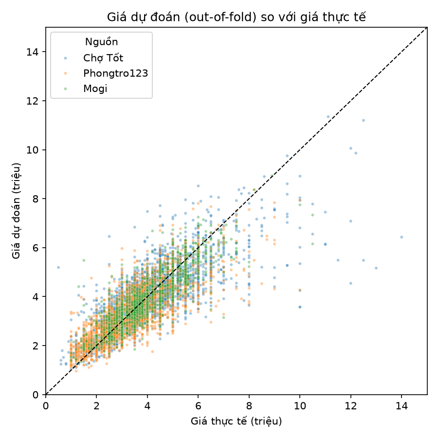

*Hình 7. Giá dự đoán (out-of-fold, GroupKFold) so với giá thực tế; đường chéo là dự đoán đúng. Đám điểm bị "nén" về
giữa: phòng rẻ bị đoán cao, phòng đắt bị đoán thấp.*

| Khoảng giá | Số tin | MAPE | Đoán lệch trung bình |
|---|---|---|---|
| ≤ 2 tr | 779 | 36,1% | +33,0% |
| 2–3 tr | 1.877 | 17,4% | +7,5% |
| 3–4 tr | 2.223 | 12,8% | +0,3% |
| 4–5 tr | 1.495 | 13,5% | −4,9% |
| 5–7 tr | 888 | 15,6% | −12,0% |
| 7–10 tr | 127 | 25,1% | −24,4% |
| > 10 tr | 20 | 41,0% | −40,8% |

- 70% tin có sai số ≤ 20%; phân khúc 2–5 triệu (~75% số tin) có MAPE 13–17%.
- Nhóm theo giá thật, mô hình **"co về trung bình"**: phòng rẻ bị đoán cao, phòng đắt bị đoán thấp.
- **Nhưng nhóm theo giá dự đoán thì mô hình không lệch.** Ở cả 6 mức giá dự đoán (< 2,5 đến > 5 triệu), giá thật trung
  bình khớp giá dự đoán, lệch nhiều nhất 2,5% trên thang log; hồi quy log giá thật theo log giá dự đoán có hệ số góc
  0,98 (lý tưởng là 1). Thử "kéo giãn" dự đoán theo đường hồi quy này không giảm sai số (MAE 0,598 → 0,596 triệu, MAPE
  17,16% → 17,16%). Vậy "co về trung bình" không phải lỗi hiệu chỉnh sửa được ở khâu sau: nó đến từ phần biến động giá
  mà đặc trưng không giải thích được (R² chỉ khoảng 0,65). Một phòng 1,5 triệu và một phòng 3 triệu có thể có mô tả gần như nhau.
- Đọc tay 15 tin bị đoán sai nặng nhất (`reports/error_analysis.md`): phần lớn là **nhiễu nhãn** — giá mồi, giá "từ...",
  giá theo giường — dẫn tới bài toán phân loại ở mục 4.7.

### 4.7. Phân loại loại tin đăng

Đánh giá trên **300 tin chọn ngẫu nhiên** (Stratified 5-fold × 5, dự đoán out-of-fold). Lần chạy này dùng 538 trong 540 tin có nhãn: 2 tin ở ghép của mẫu theo luật có giá/m² ngay dưới ngưỡng phân vị 1% mới (27,3 nghìn đồng/m²) nên bị bước làm sạch loại ra.

| Phương pháp | macro-F1 | Accuracy |
|---|---|---|
| Luật regex (khoảng giá + từ khóa ở ghép) | 0,75 | 0,83 |
| TF-IDF + Logistic Regression | 0,79 | 0,81 |
| TF-IDF + Naive Bayes | 0,70 | 0,78 |
| TF-IDF + Linear SVM | 0,79 | 0,81 |
| TF-IDF ký tự + Linear SVM | 0,77 | 0,81 |
| Luật + TF-IDF + Logistic Regression | 0,75 | 0,83 |
| **Luật v2 (+ đếm số mức giá)** | **0,88** | **0,91** |
| Luật v2 + đếm mức giá + TF-IDF + Logistic Regression | 0,88 | 0,91 |

*Chi tiết (độ lệch chuẩn, ma trận nhầm lẫn, classification report): `reports/listing_type.md`.*

- Lớp khó nhất là **N** (nhiều mức giá): luật ban đầu chỉ bắt được 34% vì người đăng liệt kê giá theo rất nhiều kiểu.
  Thêm đặc trưng **đếm số mức giá phòng khác nhau** trong mô tả nâng recall lớp N lên 90%.
- Luật v2 được thiết kế sau khi xem lỗi trên mẫu ngẫu nhiên nên điểm 0,88 trên mẫu này hơi lạc quan. Kiểm tra trên 238 tin
  của mẫu còn lại (không dùng khi thiết kế): macro-F1 0,813 → 0,853, recall lớp N 0,78 → 0,90 — cải thiện vẫn giữ.
- Luật v2 và mô hình kết hợp luật v2 + TF-IDF + Logistic Regression ngang nhau (cùng 0,876 trên mẫu
  ngẫu nhiên) → theo nguyên tắc ở mục 3.2, chọn **luật v2**: không cần huấn luyện, dễ giải thích, cũng là bộ phân
  loại dùng trong demo.
- Mô hình học máy không vượt được luật vì quá ít dữ liệu có nhãn (540 tin); đặc trưng tốt (đếm mức giá) quan trọng hơn
  thuật toán.
- **Ảnh hưởng của rà soát nhãn** (cùng một bộ dự đoán, chấm trên nhãn cũ và nhãn đã rà soát): luật v2 0,837 → 0,876;
  luật v1 0,737 → 0,745; TF-IDF + Logistic Regression 0,775 → 0,789. Luật v2 tăng nhiều nhất vì mọi nhãn được sửa đều là
  tin có khoảng giá / nhiều mức giá — đúng loại tín hiệu luật v2 đọc. Cần nói rõ: người rà soát biết cách luật v2 hoạt
  động, nên không loại trừ được thiên lệch; bù lại, mỗi thay đổi đều dẫn ra câu cụ thể trong tin (nhật ký rà soát).
- **Độ đồng thuận khi gán lại:** 100 tin lấy ngẫu nhiên từ mẫu ngẫu nhiên được gán lại độc lập theo hướng dẫn, không xem
  nhãn lần đầu. Trùng nhãn 94 / 100 tin, **Cohen's kappa 0,85** (khoảng tin cậy bootstrap 95%: 0,72–0,95). Trong 6 tin
  lệch, 5 tin lần đầu gán N còn lần hai gán R — mô tả của cả 5 tin đều có khoảng giá hoặc giá "từ" ("3,7tr – 4tr tuỳ
  phòng", "giá từ 4,7 triệu", "3,8 – 4 – 4,1 triệu"), tức là N theo hướng dẫn nhưng dễ bỏ sót khi đọc nhanh, đúng loại
  lỗi mà lần rà soát nhãn đã sửa; 1 tin còn lại là hệ thống ở ghép nhiều cơ sở, nhiều mức giá theo người (G theo thứ tự
  ưu tiên, lần hai gán N). Các bảng ở trên vẫn dùng nhãn lần đầu (`reports/label_agreement.md`).
- Áp dụng cho toàn bộ dữ liệu: 73,5% phòng riêng, 21,2% nhiều mức giá, 5,3% ở ghép (mẫu ngẫu nhiên: 71% / 22% / 7%) —
  lớp G bị đoán thiếu một chút.
- **Tác động lên mô hình giá:** chỉ huấn luyện trên tin loại R giúp dự đoán phòng riêng tốt hơn một chút: R² 0,629 → 0,635.

### 4.8. Phân cụm khu vực trọ

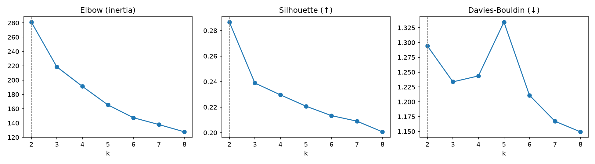

*Hình 8. Chọn số cụm k cho K-Means: inertia (elbow), Silhouette (càng cao càng tốt), Davies-Bouldin (càng thấp càng
tốt). Đường nét đứt là k được chọn.*

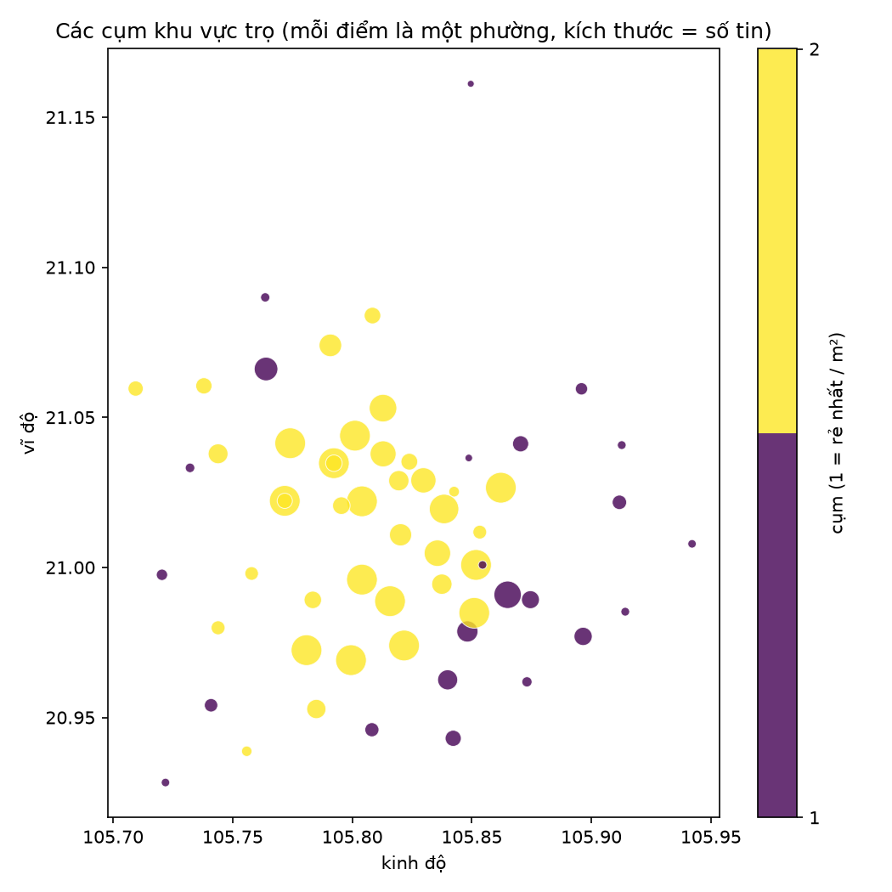

*Hình 9. Các cụm khu vực trọ: mỗi điểm là một phường, kích thước theo số tin, màu theo cụm (1 = rẻ nhất / m²).*

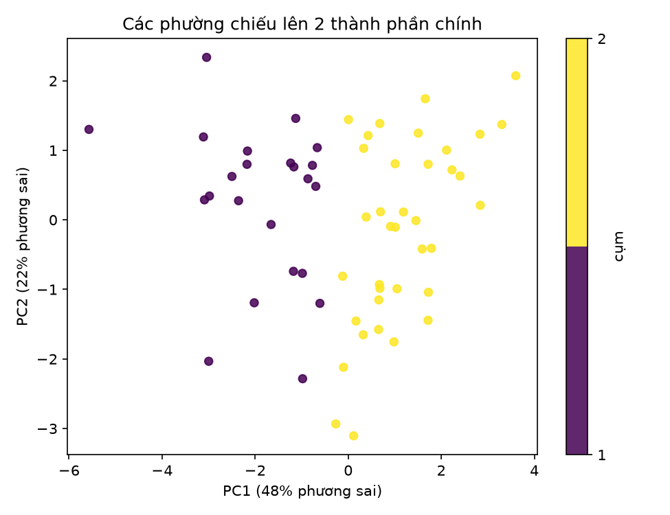

*Hình 10. Các phường chiếu lên 2 thành phần chính (PCA trên đặc trưng đã chuẩn hóa), màu theo cụm.*

60 phường có ≥ 10 tin phòng riêng.

| Bộ đặc trưng | Silhouette tốt nhất | Davies-Bouldin |
|---|---|---|
| Giá + vị trí (4) | 0,39 | 0,96 |
| Giá/m² + vị trí + 4 tiện ích (7) — dùng chính | 0,29 | 1,29 |
| Đầy đủ (15) | 0,24 | 1,55 |

| Thuật toán (k = 2) | Silhouette | Davies-Bouldin | ARI so với K-Means |
|---|---|---|---|
| K-Means | 0,29 | 1,29 | 1,00 |
| Agglomerative (Ward) | 0,29 | 1,25 | 0,43 |
| DBSCAN | 1 cụm + 3 điểm nhiễu | – | 0,03 |

**Độ ổn định.** Lặp 200 lần: lấy mẫu con 80% số phường (không hoàn lại), chọn k theo cùng quy tắc (trong các k có
Silhouette ≥ 90% mức tốt nhất, lấy k có Davies-Bouldin nhỏ nhất) và so cụm với kết quả trên toàn bộ.

| k được chọn | 2 | 3 | 4 | 5 | 6–8 |
|---|---|---|---|---|---|
| Tỉ lệ | 75,5% | 17,5% | 3,5% | 2,0% | 1,5% |

ARI giữa cụm học trên mẫu con và trên toàn bộ (k = 2): trung vị 0,93. Ghi chú phương pháp: lần thử đầu dùng bootstrap
(lấy mẫu **có** hoàn lại) chọn k = 8 tới 52% số lần — các điểm trùng trong mẫu tạo thành "cụm" giả rất chặt làm chỉ số
chọn k thiên về nhiều cụm, nên nhóm chuyển sang lấy mẫu con không hoàn lại.

Kết quả K-Means (k = 2):

| | Khu giá thấp | Khu giá cao |
|---|---|---|
| Số phường / số tin | 23 / 1.046 | 37 / 6.046 |
| Giá/m² trung vị | ~104 nghìn | ~140 nghìn |
| Khoảng cách tới trường ĐH gần nhất | ~5,2 km | ~2,0 km |
| Tỉ lệ tin "full đồ" / chung cư mini / thang máy | 26% / 5% / 14% | 41% / 12% / 24% |
| Phường tiêu biểu | Vĩnh Tuy, Đông Ngạc, Hoàng Mai, Hoàng Liệt | Từ Liêm, Định Công, Hà Đông, Khương Đình |

**Nhận xét:** cách chia thành **khu giá thấp** (xa trường đại học, phòng trọ truyền thống) và **khu giá cao** (gần trường,
nhiều chung cư mini, full đồ, thang máy) là ổn định (k = 2 được chọn 76% số lần, ARI 0,93). Các cách chia mịn hơn (k = 3,
4 — chẳng hạn tách riêng nội đô gần trung tâm khỏi khu chung cư mini quanh trường) xuất hiện ở một phần mẫu nhưng không
ổn định; các lần chạy trên dữ liệu cũ từng chọn k = 3 hoặc 4 vì thế. Silhouette chỉ 0,20–0,29 → giá phòng trọ thay đổi
liên tục theo không gian hơn là chia thành các khu tách biệt. Thêm nhiều đặc trưng tỉ lệ tiện ích làm cụm mờ đi (60 điểm,
15 chiều); khoảng cách phải lấy log, nếu không xã Hòa Lạc (36 km) chiếm riêng một cụm; DBSCAN không phù hợp vì mật độ điểm
gần như đồng đều.

### 4.9. Luật kết hợp

7.409 giao dịch, 26 item; mức giá theo tam phân vị (thấp ≤ 3,0 triệu < trung bình ≤ 4,2 triệu < cao). Tìm được 3.230
luật thỏa ngưỡng.

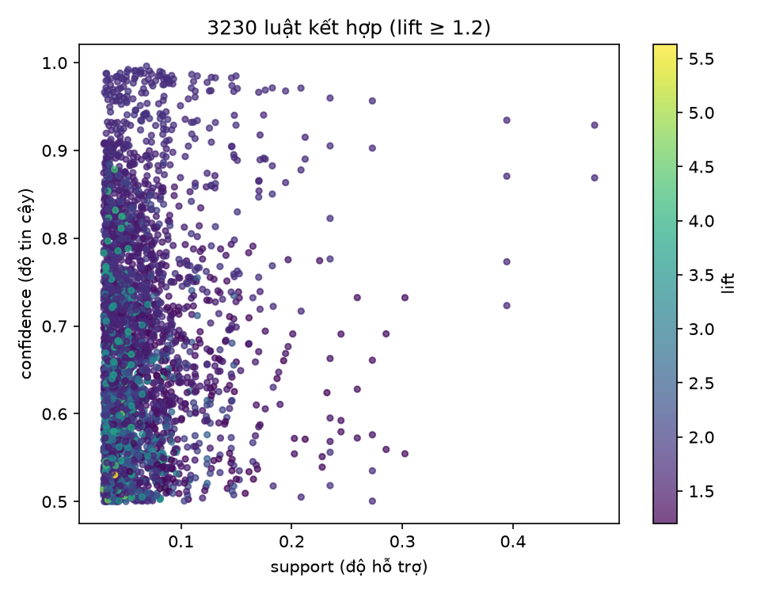

*Hình 11. Các luật kết hợp tìm được: trục ngang là support, trục dọc là confidence, màu là lift. Phần lớn luật có
support thấp (0,03–0,1); các luật lift cao (màu sáng) là các nhóm tiện ích hay đi cùng nhau.*

| Luật | Support | Confidence | Lift |
|---|---|---|---|
| {1 ngủ, máy giặt} → giá cao | 0,031 | 0,79 | 2,53 |
| {studio, full đồ} → giá cao | 0,033 | 0,61 | 1,97 |
| {1 ngủ, khu giá cao, full đồ} → giá cao | 0,031 | 0,71 | 2,28 |
| {khu giá thấp, khép kín} → giá thấp | 0,039 | 0,63 | 1,75 |
| {gác xép, khép kín} → giá thấp | 0,033 | 0,61 | 1,70 |
| {ban công, khép kín, khóa vân tay} → camera | 0,031 | 0,73 | 4,21 |
| {ban công, camera, thang máy} → khóa vân tay | 0,040 | 0,88 | 4,27 |

- Giá cao gắn với **loại phòng** (1 ngủ, studio) và **tiện ích riêng** (máy giặt riêng, full đồ, thang máy) — khớp với hệ số TF-IDF.
- "Gác xép + khép kín" là kiểu phòng trọ truyền thống giá thấp.
- Có một **"gói an ninh chung cư mini"**: camera, khóa vân tay, thang máy, ban công thường xuất hiện cùng nhau (lift 4,2–4,3)
  — các tòa CCMN mới xây quảng cáo theo cùng một mẫu.

---

## 5. Hệ thống demo

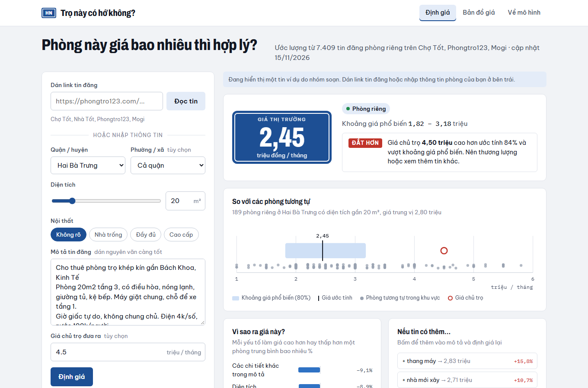

*Hình 12. Trang Định giá: nhập thông tin hoặc dán link tin đăng; bên phải là giá ước tính, khoảng giá 80%, nhận xét so
với giá chủ trọ và vị trí của phòng so với các phòng tương tự trong khu vực.*

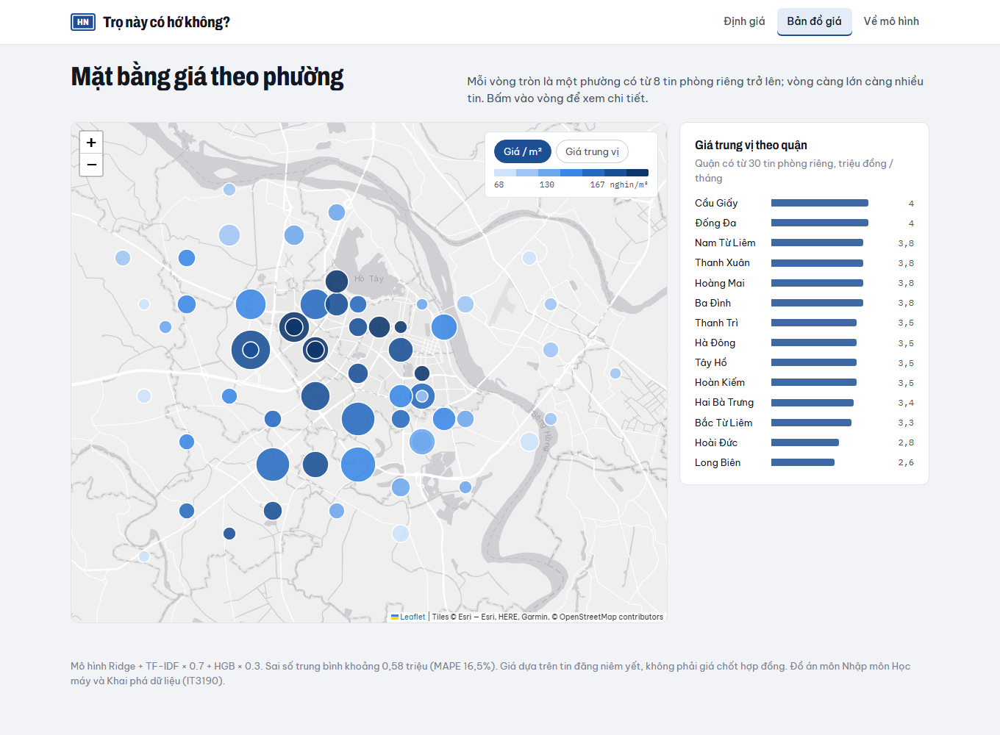

*Hình 13. Trang Bản đồ giá: mặt bằng giá / m² theo phường và xếp hạng giá trung vị theo quận.*

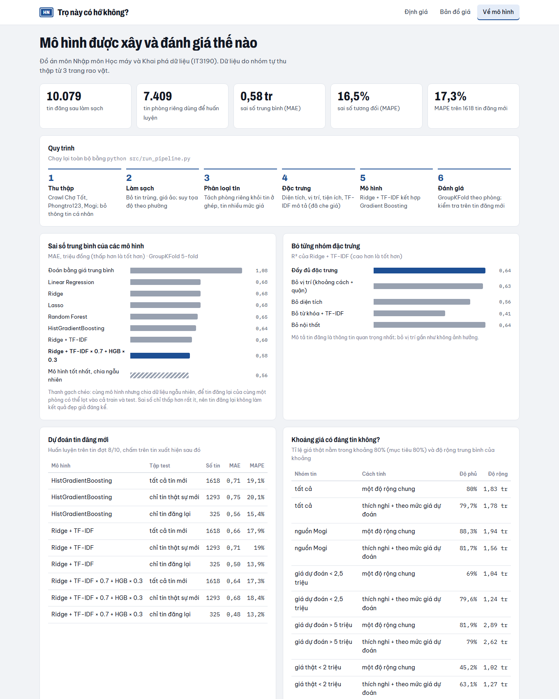

*Hình 14. Trang Về mô hình: các số liệu đánh giá ở mục 4 trình bày dưới dạng biểu đồ.*

**Kiến trúc:** backend FastAPI (`web/server.py`) nạp mô hình đã huấn luyện; frontend HTML/CSS/JavaScript thuần
(`web/static/`). Font và thư viện bản đồ (Leaflet) được lưu sẵn trong máy nên ứng dụng chạy được không cần mạng
(trừ nền bản đồ). Nền bản đồ lấy từ Esri (bản xám sáng / tối theo giao diện); một số mạng chặn máy chủ ô bản đồ của
OpenStreetMap nên OSM chỉ là nguồn dự phòng.

| API | Chức năng |
|---|---|
| `GET /api/meta` | danh sách quận / phường, thông tin mô hình |
| `POST /api/predict` | giá ước tính, khoảng giá 80%, loại tin, giải thích, gợi ý "nếu có thêm", tin tương tự |
| `GET /api/fetch?url=` | đọc một tin đăng từ Chợ Tốt / Nhà Tốt / Phongtro123 / Mogi để điền sẵn |
| `GET /api/map` | mặt bằng giá theo phường cho bản đồ |
| `GET /api/about` | số liệu đánh giá mô hình |

**Trang Định giá:**
- **Dán link tin đăng** → hệ thống đọc tin (dùng lại các hàm phân tích của crawler), điền quận, phường, diện tích, nội thất,
  mô tả, giá đăng và định giá ngay; hoặc nhập tay.
- Giá ước tính (trình bày như biển số nhà Hà Nội), khoảng giá 80%, nhận xét **đắt hơn / hợp lý / rẻ hơn** so với giá chủ trọ.
- **Nhận diện loại tin** bằng bộ phân loại ở mục 3.2: cảnh báo khi tin là ở ghép hoặc liệt kê nhiều mức giá.
- Biểu đồ đặt giá ước tính, khoảng giá và giá chủ trọ lên cùng một trục với giá của các phòng tương tự trong khu vực.
- **"Vì sao ra giá này?"** — đóng góp của từng yếu tố (diện tích, vị trí, nội thất, từng tiện ích) so với một phòng trung
  bình, tính trên phần tuyến tính của mô hình: đóng góp = hệ số × (giá trị − trung bình), quy đổi ra %. Các token TF-IDF
  được gộp vào tiện ích chứa chúng (ví dụ "sinh khép" thuộc "vệ sinh khép kín").
- **"Nếu tin có thêm…"** — định giá lại khi thêm từng tiện ích còn thiếu (thang máy, máy giặt riêng, full đồ…), tính theo lô
  trong một lần gọi mô hình; bấm để thêm vào mô tả.
- Kéo thanh diện tích, đổi nội thất, đổi quận → định giá lại ngay.

**Trang Bản đồ giá:** mỗi phường là một vòng tròn (màu theo giá / m² hoặc giá trung vị, kích thước theo số tin);
xếp hạng giá trung vị theo quận. **Trang Về mô hình:** các số liệu ở mục 4 dưới dạng biểu đồ.

**Kiểm thử:** `tests/test_web_api.py` kiểm tra khoảng giá hợp lệ, nhận xét đúng, giá ghi trong mô tả không làm đổi kết
quả (chống rò rỉ), phòng lớn hơn đắt hơn, nhận diện tin ở ghép, dữ liệu trả về hợp lệ JSON.

**Cách chạy:** nhấp đúp `chay_demo.bat` (hoặc `python web/server.py --open`), trình duyệt mở `http://localhost:8000`.

---

## 6. Cấu trúc mã nguồn

| File | Vai trò | Hàm / thành phần chính |
|---|---|---|
| `src/common.py` | cấu hình, hàm dùng chung | `polite_get` (request có giãn cách + thử lại), `mask_phone`, `haversine_km` |
| `src/crawl_chotot.py`, `crawl_phongtro123.py`, `crawl_mogi.py` | thu thập dữ liệu | `parse_list_page`, `parse_detail`, `crawl_details` (chạy tiếp được khi bị ngắt) |
| `src/crawl_all.py` | chạy mọi crawler, lặp định kỳ | `run_once` |
| `src/build_dataset.py` | làm sạch, tích hợp | `load_*` cho từng nguồn, `fill_coords`, `size_from_text`, `room_groups` |
| `src/features.py` | đặc trưng | `add_features`, `mask_money`, `strip_accents`, `load_rooms` |
| `src/listing_type.py` | phân loại loại tin | `rule_predict`, `rule_v2_predict`, `room_prices`, `classifiers` |
| `src/train.py` | hồi quy, chọn mô hình | `models`, `evaluate`, `metrics` |
| `src/intervals.py` | khoảng giá thích nghi (conformal) | `difficulty_model`, `pred_bin` |
| `src/temporal_validation.py` | kiểm tra trên tin mới (sai số, độ phủ khoảng giá) | `first_seen` |
| `src/experiments.py` | thí nghiệm A–G | ablation, nested CV, chọn alpha, kết hợp mô hình, đặc trưng phường |
| `src/extra_experiments.py` | thí nghiệm H–I | tham số TF-IDF, stacking |
| `src/error_analysis.py` | phân tích lỗi | sai số theo nhóm, hệ số TF-IDF, `calibration_section` |
| `src/label_agreement.py`, `src/label_tool.py` | độ đồng thuận giữa hai người gán nhãn; trang gán nhãn | `make_sample`, `agreement` (Cohen's kappa) |
| `src/clustering.py` | phân cụm | `ward_table`, `choose_k` |
| `src/association_rules.py` | luật kết hợp | `transactions` |
| `src/run_pipeline.py` | chạy toàn bộ theo thứ tự | |
| `web/server.py`, `web/static/` | demo web | `predict` |
| `tests/` | kiểm thử | 53 test: xử lý văn bản, luật phân loại, gom tin trùng, khoảng giá, API web |

---

## 7. Khó khăn và giải pháp

| Khó khăn | Giải pháp |
|---|---|
| Dịch vụ geocode bị chặn, 2/3 nguồn không có tọa độ | Suy tọa độ theo trung vị phường từ Chợ Tốt; kiểm chứng bằng thí nghiệm D (không mất độ chính xác) |
| Phongtro123 chỉ hiển thị ~4.900 tin qua phân trang; Mogi từ 16/10 chỉ còn ~260 tin | Giữ dữ liệu các lượt crawl trước; crawl theo quận không lấy thêm được tin mới |
| Địa giới hành chính 2025 khác nhau giữa các nguồn | Bảng đối chiếu phường cũ ↔ mới học từ dữ liệu Chợ Tốt |
| Giá ghi trong mô tả làm rò rỉ nhãn | Hàm `mask_money` + unit test; kiểm chứng trên demo (đổi giá ghi trong mô tả không đổi kết quả) |
| Tin trùng có thể làm kết quả CV đẹp giả | `group_id` (đồ thị cặp tin trùng) + GroupKFold |
| Phiên bản gom nhóm đầu gộp nhầm mọi tin thiếu diện tích thành một "phòng", làm sai kết luận đánh giá | Phát hiện qua nhóm bất thường (> 1.200 tin); gom lại theo từng cặp tin, thêm unit test |
| Máy 8 GB RAM hết bộ nhớ khi tinh chỉnh song song | Giảm số worker; tiến trình chạy ở mức ưu tiên thấp |
| `RidgeCV` trên ma trận TF-IDF lớn rất chậm (~2 phút/lần) | Chọn alpha một lần bằng CV rồi cố định → nhanh ~50 lần |

**Phân công công việc:** *[bảng: thành viên — phần việc]*

---

## 8. Kết luận

### 8.1. Kết quả đạt được

- Bộ dữ liệu 10.079 tin cho thuê phòng trọ Hà Nội tự thu thập từ 3 nguồn trong 7 lượt crawl, kèm quy trình làm sạch có
  thể chạy lại.
- Mô hình dự đoán giá thuê phòng riêng với sai số trung bình **~0,58 triệu (MAPE 16,5%, R² 0,66)**, giữ được độ chính
  xác trên tin đăng xuất hiện sau thời điểm huấn luyện (MAPE 17,3%; 18,4% trên phòng thật sự mới), kèm khoảng giá 80%
  thích nghi theo từng tin, phủ ~80% ở mọi nguồn tin và mọi mức giá dự đoán trong cross-validation (~79% trên tin đăng mới).
- Hệ thống web cho phép sinh viên kiểm tra một tin đăng có đắt hay rẻ so với mặt bằng.

### 8.2. Các phát hiện chính

1. **Mô tả tin đăng quan trọng hơn vị trí** trong việc xác định giá thuê phòng trọ (bỏ văn bản: R² 0,64 → 0,41; bỏ vị trí:
   0,64 → 0,63).
2. **Rò rỉ dữ liệu:** giá ghi ngay trong mô tả (~60% tin) phải được che. Với tin đăng lại, sau khi sửa lỗi gom nhóm, chênh
   lệch giữa chia theo nhóm và chia ngẫu nhiên chỉ ~0,01 R². Con số ~0,08 ở phiên bản đầu là do lỗi gom nhóm, không phải
   rò rỉ — một bước tiền xử lý sai có thể làm sai cả kết luận đánh giá.
3. **Nhiều lỗi "của mô hình" thực ra là nhiễu nhãn** (giá theo giường, giá "từ...", nhiều mức giá). Phân loại loại tin
   và chỉ học trên phòng riêng cải thiện mô hình giá.
4. **Cách lấy mẫu và chất lượng nhãn quyết định con số đánh giá:** điểm của luật phân loại trên mẫu chọn theo chính
   luật đó là 0,81, trên mẫu ngẫu nhiên chỉ 0,75; rà soát lại nhãn (4,8% nhãn sai) làm điểm luật v2 đổi từ 0,84 lên 0,88.
5. **Tương quan không phải nhân quả:** tin quảng cáo "khép kín" lại rẻ hơn trung bình.
6. **Giới hạn nằm ở dữ liệu, không ở thuật toán:** tinh chỉnh HGB (kể cả bằng nested CV), TF-IDF ký tự, đặc trưng phường
   đều không cải thiện; stacking kém hơn trung bình có trọng số; cấu trúc cụm khu vực yếu (chỉ cách chia 2 khu giá thấp /
   cao là ổn định).
7. **Chia nhóm theo giá thật hay giá dự đoán cho kết luận khác nhau.** Theo giá thật, mô hình đoán cao phòng rẻ tới 33%
   và khoảng giá chỉ phủ 45–66%; theo giá dự đoán, mô hình lệch không quá 3% và khoảng giá phủ đúng 80%. Cách chia thứ
   hai mới là điều người dùng gặp, vì họ không biết giá thật.

### 8.3. Hạn chế

- Giá là **giá niêm yết**, không phải giá chốt hợp đồng; có tin dùng giá mồi.
- Dữ liệu chỉ trong hơn 5 tuần (08/10–15/11/2026), giá trọ có tính mùa vụ (cao điểm tháng 8–9).
- Khoảng giá 80% phủ đúng trong cross-validation nhưng chỉ phủ ~79% trên tin đăng mới (77% với phòng thật sự mới).
- Tọa độ Phongtro123 / Mogi chỉ chính xác tới mức phường; tọa độ các trường đại học là gần đúng.
- Nhãn loại tin chỉ có 540 tin; độ đồng thuận mới đo trên 100 tin với một lượt gán lại độc lập (kappa 0,85, khoảng tin
  cậy 0,72–0,95); luật v2 được thiết kế sau khi xem lỗi trên mẫu ngẫu nhiên.
- Phòng có giá thật rất rẻ / rất đắt vẫn bị đoán lệch về giữa và hay nằm ngoài khoảng giá: mô tả tin đăng không đủ để
  nhận ra các phòng này (mục 4.6). Khoảng giá chỉ bảo đảm độ phủ theo mức giá dự đoán.

### 8.4. Hướng phát triển

- Thu thập dữ liệu dài hơn để nắm tính mùa vụ; thêm nguồn tin.
- Dùng ảnh tin đăng (mức độ mới, nội thất) làm đặc trưng.
- Mô hình ngôn ngữ cho tiếng Việt (PhoBERT) thay cho TF-IDF.
- Thay 6 mức giá dự đoán cố định bằng hồi quy phân vị, để khoảng giá thay đổi trơn theo giá.
